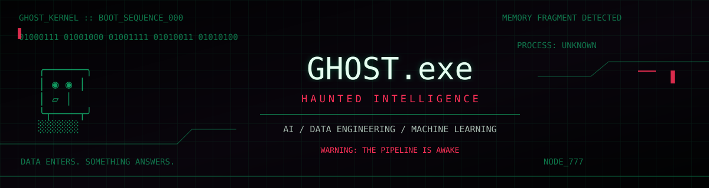

<div align="center">




<br/>


</div>

---

```text
╔════════════════════════════════════════════════════════════╗
║  /dev/ghost :: IDENTITY SCAN                               ║
╠════════════════════════════════════════════════════════════╣
║  OPERATOR  : Chaitanya Karanam                             ║
║  DOMAIN    : AI / DATA ENGINEERING                         ║
║  PROCESS   : MACHINE LEARNING                              ║
║  MEMORY    : POSTGRESQL / DATA WAREHOUSE                   ║
║  SIGNAL    : PYTHON / SQL / JAVA                           ║
║  WARNING   : UNKNOWN DATA MAY RETURN                       ║
╚════════════════════════════════════════════════════════════╝
```

## `01 // THE ENTITY`

```python
class GhostKernel:
    operator = "Chaitanya Karanam"
    domains = [
        "Data Engineering",
        "Machine Learning",
        "Backend Systems",
        "Cloud Infrastructure",
    ]
    languages = ["Python", "SQL", "Java"]

    def process(self, raw_data):
        # noise becomes signal
        return "transform -> validate -> deliver"
```

A Computer Science student exploring the machinery behind intelligent systems: data pipelines, model-driven applications, APIs, and reliable infrastructure.

`[ SIGNAL FOUND ]` ` [ PROCESS ACTIVE ]` ` [ MEMORY PERSISTENT ]`

## `02 // THE SUMMONING CIRCLE`

<div align="center">


</div>

```text
01 :: INGEST       -> Python / REST APIs
02 :: TRANSFORM    -> SQL / dbt / ETL
03 :: STORE        -> PostgreSQL / MySQL
04 :: PREDICT      -> Machine Learning / Scikit-learn
05 :: SERVE        -> FastAPI / REST
06 :: CONTAIN       -> Docker / Cloud
```

## `03 // HAUNTED PROJECT ARCHIVE`

<details>
<summary>◉ <b>ENTITY_001 :: SAFESCHED</b></summary>

A deadlock-aware scheduling system combining Logistic Regression and the Banker's Algorithm to evaluate resource-allocation states.

`PYTHON` `ML` `FASTAPI` `DOCKER`

</details>

<details>
<summary>◉ <b>ENTITY_002 :: PIPEONE</b></summary>

An API-to-warehouse pipeline ingesting GitHub Events and Hacker News data, deduplicating records, upserting PostgreSQL, and transforming data with dbt.

`PYTHON` `POSTGRESQL` `DBT` `STREAMLIT`

</details>

<details>
<summary>◉ <b>ENTITY_003 :: MOVIEFLIX</b></summary>

A machine learning application exploring prediction workflows, backend integration, and containerized deployment.

`PYTHON` `MACHINE LEARNING` `DOCKER`

</details>

## `04 // PARANORMAL TELEMETRY`

<div align="center">


</div>

## `05 // UNFINISHED PROCESSES`

```text
[ ACTIVE ]   Python / SQL
[ ACTIVE ]   Data pipelines / Warehousing
[ ACTIVE ]   AI / ML application development
[ OBSERVING ] Streaming / Cloud architecture
[ UNKNOWN ]  Next process awaiting initialization
```

## `06 // LAST TRANSMISSION`

<div align="center">

[](https://github.com/chaitanyakaranam777?tab=repositories)

```text
THE PROCESS DID NOT EXIT.
IT IS STILL LISTENING.
```

<sub>DATA LEAVES TRACES. SYSTEMS KEEP SECRETS.</sub>

</div>
