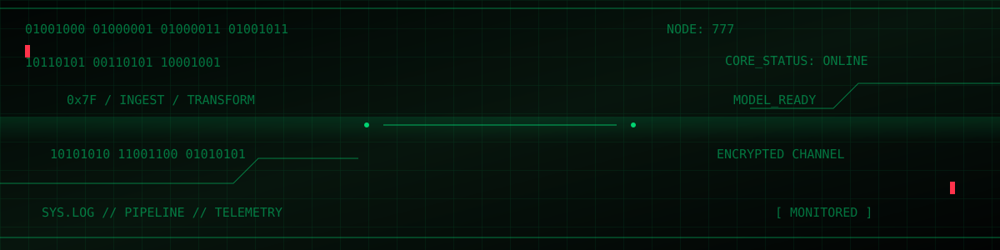

<div align="center">




<br/>


</div>

---

<table>
<tr>
<td>

**`/sys/operator`**

```text
NAME     : Chaitanya Karanam
ROLE     : AI & Data Engineer in Progress
FOCUS    : Pipelines / ML / Systems
MODE     : BUILD - TEST - DEPLOY
DIRECTIVE: Turn data into intelligence
```

</td>
</tr>
</table>

## `01 :: SYSTEM MAP`

<div align="center">


</div>

<table>
<tr>
<td width="50%">

**`[ DATA PLANE ]`**

- Python / SQL
- ETL and ELT pipelines
- PostgreSQL / MySQL
- dbt transformations
- API ingestion
- Data modeling

</td>
<td width="50%">

**`[ INTELLIGENCE PLANE ]`**

- Machine learning
- Scikit-learn
- Pandas / NumPy
- FastAPI services
- Docker containers
- Cloud fundamentals

</td>
</tr>
</table>

## `02 :: PROJECT VAULT`

<details>
<summary><b><code>01 / SAFESCHED</code> — DEADLOCK INTELLIGENCE</b></summary>

```text
TYPE       : RESOURCE SCHEDULING
PREDICTOR  : LOGISTIC REGRESSION
VALIDATOR  : BANKER'S ALGORITHM
API        : FASTAPI
DEPLOYMENT : AWS APP RUNNER / DOCKER
```

An intelligent scheduling project combining ML classification with algorithmic verification of resource-allocation states.

`PYTHON` `MACHINE LEARNING` `FASTAPI` `DOCKER`

</details>

<details>
<summary><b><code>02 / PIPEONE</code> — DATA WAREHOUSE ENGINE</b></summary>

```text
SOURCES    : GITHUB EVENTS / HACKER NEWS
INGESTION  : PYTHON API CLIENTS
WAREHOUSE  : POSTGRESQL
TRANSFORM  : DBT
VISUALS    : STREAMLIT
```

An ETL workflow with ingestion, deduplication, database upserts, transformations, and an analytics dashboard.

`PYTHON` `POSTGRESQL` `DBT` `STREAMLIT`

</details>

<details>
<summary><b><code>03 / MOVIEFLIX</code> — PREDICTION SYSTEM</b></summary>

A machine-learning application exploring prediction workflows, backend integration, and containerized deployment.

`PYTHON` `MACHINE LEARNING` `DOCKER`

</details>

## `03 :: LIVE TELEMETRY`

<div align="center">


</div>

## `04 :: EXECUTION QUEUE`

```text
[ ACTIVE ]  Python / SQL engineering
[ ACTIVE ]  ETL and warehouse development
[ ACTIVE ]  AI / ML applications
[ EXPLORING ] Cloud and streaming architecture
[ NEXT ]    Production-grade data systems
```

## `05 :: CONNECT`

<div align="center">

<a href="https://github.com/chaitanyakaranam777?tab=repositories">

</a>

<br/><br/>

<sub>DATA IS THE SIGNAL. ENGINEERING IS THE EDGE.</sub>

```text
CONNECTION STATUS : OPEN
NODE              : 777
END OF TRANSMISSION_
```

</div>
